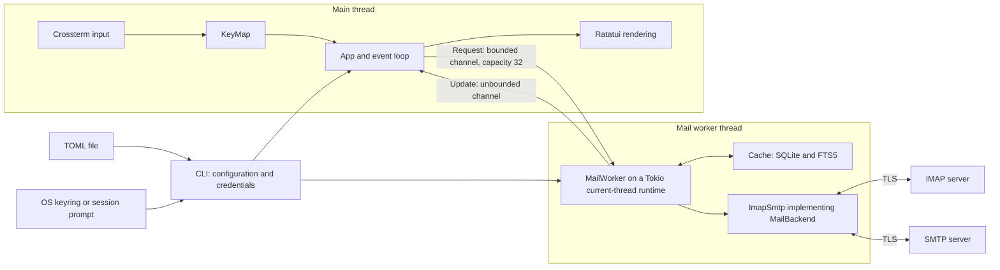
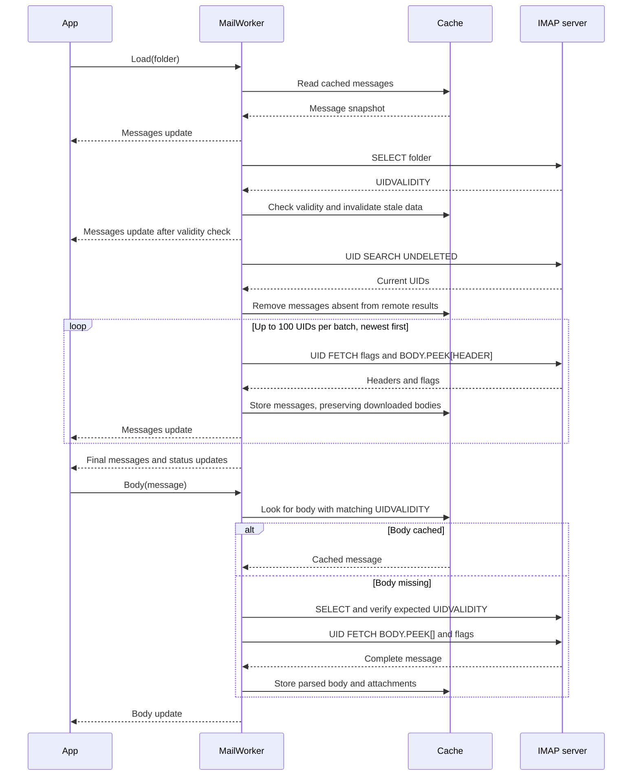
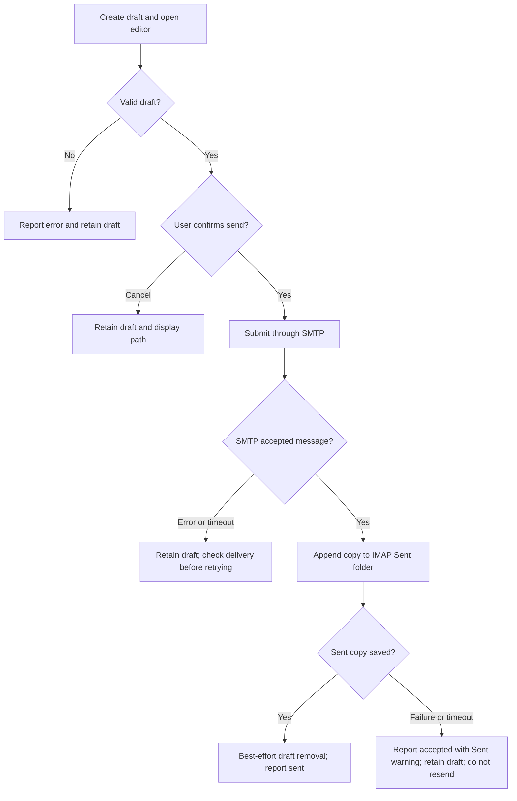

# Developer guide

This guide describes the current implementation of TerminalEmail and how to
extend it. For account setup and everyday navigation, start with the
[README](../README.md) and [example configuration](../config.example.toml).

## Local development

Use stable Rust with the `rustfmt` and `clippy` components. Linux builds require
a C compiler, `pkg-config`, OpenSSL development files, and D-Bus development
files. SQLite is bundled through `rusqlite`; no separate SQLite server is needed.
On Arch Linux, the system packages are `base-devel`, `pkgconf`, `openssl`, and
`dbus`. The [CI workflow](../.github/workflows/ci.yml) lists Ubuntu packages.

```sh
rustup component add rustfmt clippy
cargo build
cargo run -- demo
cargo run -- --config config.example.toml check-config
```

The demo uses in-memory sample conversations without contacting mail servers.
Composing in demo mode still creates a local draft and launches the configured
editor, but confirmation never sends mail. `check-config` checks syntax and
settings without testing credentials or connectivity.

## Code map

This is a single binary crate; module interfaces are internal, not a published
Rust library API.

| Module | Responsibility |
| --- | --- |
| [`main`](../src/main.rs) | CLI commands, setup, credential lookup and prompting. |
| [`app`](../src/app.rs) | Views, selection, prompts, actions, and event loop. |
| [`ui`](../src/ui.rs) | Ratatui rendering, layout, wrapping, and overlays. |
| [`keys`](../src/keys.rs) | Command names, default bindings, sequence dispatch. |
| [`config`](../src/config.rs) | Typed TOML, validation, paths, credential identity. |
| [`model`](../src/model.rs) | Mail types, MIME parsing, text safety, threading. |
| [`compose`](../src/compose.rs) | Draft files, external editor, outgoing mail, saves. |
| [`cache`](../src/cache.rs) | SQLite schema, message persistence, local search. |
| [`mail`](../src/mail.rs) | Worker, request/update types, IMAP and SMTP adapter. |

## Runtime architecture

The terminal runs on the main thread. `App` owns presentation state and a
`KeyMap`; the event loop receives Crossterm input, resolves commands, drains
worker updates, and redraws when state changes. Rendering also updates viewport
information such as page height and clamps reader scrolling.



Startup opens the cache and constructs the backend before moving them into the
worker thread. The worker then owns database and network operations. Its
`MailWorker<B>` uses the private `MailBackend` trait, allowing tests to substitute
a fake backend without involving the terminal.

Requests execute sequentially, including local search. A long synchronization can
delay later requests even though the terminal remains responsive. UI requests
use `try_send`; a full or disconnected request channel produces a status error.
This channel is an in-memory work queue, not a durable offline operation queue.

The input loop polls at 50 ms intervals. While online, it requests a refresh of
the active folder every 60 seconds. There is no IMAP IDLE subscription. An error
or request timeout drops the IMAP session; a later request can reconnect, but the
failed operation is not automatically retried.

## Mailbox and message loading

Startup requests `Refresh("INBOX")`. `Refresh` publishes cached messages first,
then lists remote folders and unread counts, persists SPECIAL-USE roles, and
synchronizes the requested folder. `Load` publishes that folder's cache and
synchronizes it without relisting folders. The following diagram shows `Load`
and the subsequent download of a body that is not already in memory.



Each sync fetches headers and flags for the current undeleted UID set; it is not
a delta sync based on modification sequences. Downloaded bodies and attachments
survive header refreshes. `BODY.PEEK` avoids marking messages read as a fetch
side effect; opening an unread message online separately requests a read-flag
update.

`App` groups messages using Message-ID, References, and In-Reply-To, including
replies sharing a missing parent. Messages with no connecting identifiers remain
separate. Updates are checked against the active folder; body updates also
require matching UID and UIDVALIDITY.

## Cache and local data

Paths use XDG base directories on Linux. `--config PATH` overrides only the
configuration file location, not the cache or draft directories.

| Data | Default Linux location |
| --- | --- |
| Configuration | `~/.config/terminal-email/config.toml` |
| Mail cache | `~/.cache/terminal-email/<account-id>/mail.db` |
| Retained drafts | `~/.local/share/terminal-email/drafts/draft-*.eml` |
| Password | Secret Service entry with service `terminal-email` |

The credential identity is `username@imap-host:imap-port`. The cache directory
uses a hash of that identity. Changing those settings selects a different cache
and keyring entry; changing only the config filename does not isolate an
account's data. See `Config::credential_key` and `cache_path` before changing
identity or directory rules.

The current SQLite schema uses WAL mode and `PRAGMA user_version = 1`:

| Table | Contents and identity |
| --- | --- |
| `folders` | Name, unread count, special-use role, and UIDVALIDITY. |
| `messages` | `(folder, uid)` primary key and serialized `Message` JSON. |
| `search` | FTS5 fields for sender, recipients, subject, and body. |

Message JSON includes downloaded body text, attachment metadata and bytes, flags,
and the message's UIDVALIDITY. There is no separate attachment table or raw
message archive. A UID is meaningful only within its folder and UIDVALIDITY.
Changing UIDVALIDITY clears that folder's messages and search index before new
messages are published. Message mutations verify the expected UIDVALIDITY before
acting on a UID.

Message writes and corresponding FTS replacements share a transaction. Remote
removal reconciliation and folder removal also delete associated search rows.
Search quotes whitespace-separated input terms and combines them with AND,
limits matches to the active folder, and searches only cached content. The UI
keeps matching conversations together, including their nonmatching messages.

The database is unencrypted. App-owned directories use mode `0700`, and the
database and newly created configuration files use `0600` on Unix. Secrets stay
in the keyring or process memory; mail bodies and draft files are still private
user data. Do not add credential or message-body logging when debugging.

## Configuration and input dispatch

`Config::load` deserializes TOML and validates account settings, editor arguments,
and bindings. Configuration is loaded at startup; there is no live reload. The
[example file](../config.example.toml) is the public configuration example.

Bindings map key sequences to named commands in `global`, `folders`, `threads`,
`message`, and `prompt` contexts. Context bindings override equivalent global
sequences. `unbound` removes a binding's action. Equivalent spellings such as
`gg` and `g g` can override defaults, but defining both in the same user context
is rejected.

An exact match executes immediately unless it also prefixes a longer sequence.
Ambiguous matches wait for `timeout_ms`, defaulting to 750 ms; the accepted range
is 50–10000 ms. Escape cancels a pending sequence, and changing context clears
pending input. Text prompts use `prompt.accept`, `prompt.cancel`, and
`prompt.delete`; printable input is otherwise handled as text. Confirmation
prompts additionally interpret `y` and `n`.

## Composition and send outcomes

`Draft::create` writes an editable header/body file into the draft directory.
The event loop restores the terminal, invokes `[editor].command`, `$EDITOR`, or
`vi` in that order, waits for the editor, and reinitializes the TUI. Commands are
split into executable arguments with `shell-words`; they are not shell scripts.
`TerminalGuard` and Ratatui's panic hook restore terminal modes on failure.

After editing, draft validation builds a Lettre message and the UI asks for send
confirmation. Replies set threading headers; Bcc recipients are retained in the
SMTP envelope and omitted from transmitted headers. Recipient and subject
validation errors leave the draft on disk.



SMTP acceptance and Sent-copy persistence are separate outcomes. The UI currently
uses the word "Delivered" in a Sent-copy warning; this means SMTP accepted the
submission, not that a recipient's inbox has confirmed delivery. Sent-copy
failure must not become a send failure or cause an automatic resend.

The worker's outer request deadline is 120 seconds, the SMTP transport timeout
is 45 seconds, and Sent-copy upload has a 30-second deadline. A lost connection
can leave an operation's outcome uncertain. Preserve that distinction when
adding retries or improving status reporting.

## Extending the client

### Add a command or keybinding

1. Register the command in `keys::COMMANDS`; add default bindings only in the
   relevant contexts.
2. Implement dispatch in `App::command`, or in the prompt handling path for a
   prompt action. Help reads bindings from `KeyMap` rather than a separate list.
3. For backend work, add a `Request` and any required `Update`, handle them in
   `MailWorker` and `App::update`, and keep blocking work out of the event loop.
4. Test sequence matching, context overrides, and the resulting application
   behavior. Update user-facing bindings in the README when defaults change.

### Add a configuration field

1. Extend the appropriate Serde type, supply a backward-compatible default for
   optional behavior, and add validation in `Config::validate` where needed.
2. Wire the value into behavior and update interactive setup if users need to
   choose it there. Update the example TOML and README.
3. Test existing configurations with the field omitted, a valid explicit value,
   and invalid values. Configuration examples are parsed by a unit test.

### Add a backend operation

1. Define the worker request and result, extend `MailBackend` when protocol work
   is needed, and implement `ImapSmtp` and the fake backend in the same change.
2. Use folder, UID, and UIDVALIDITY together for message identity. Apply cache
   updates after confirmed server mutations and keep FTS data consistent.
3. Exercise success, failure, stale identity, and any ambiguous timeout outcome.
   Never automatically repeat sends or mutations after an uncertain result.

### Change persistence

1. Add an explicit transactional migration in `Cache::open` and increment
   `user_version`. The current opener creates version 1 and rejects newer
   versions; it is not a general migration framework yet.
2. Account for both table changes and serialized `Message` compatibility.
   Preserve downloaded bodies and attachment bytes, and rebuild FTS if needed.
3. Test upgrades from an existing database, search consistency, UIDVALIDITY
   invalidation, and rejection of unsupported newer versions.

## Tests and verification

Run the same checks as CI from the repository root:

```sh
cargo fmt --check
cargo clippy --all-targets -- -D warnings
cargo test
cargo build --release
```

Most modules contain inline unit tests. Worker and protocol tests live in
[`src/mail/tests.rs`](../src/mail/tests.rs). Useful focused runs are:

```sh
cargo test keys::tests
cargo test app::tests
cargo test mail::tests
cargo test ui::tests
```

Tests cover key sequences, context overrides, prompt remapping, cache/search
consistency, threading, MIME and HTML handling, Bcc privacy, draft validation,
attachment overwrite protection, and UI rendering at multiple sizes. Worker
tests use a fake backend and temporary databases. Protocol tests bind loopback
TCP ports, generate an ephemeral TLS certificate, and test real IMAP adapter
operations plus IMAP/SMTP refusal to authenticate without required TLS.

The suite requires local socket access but does not require real credentials,
an OS keyring session, or external mail servers. It does not establish live
provider compatibility or test successful SMTP delivery to a real account.
For manual TUI checks, use demo mode to verify navigation, resize behavior,
prompts, and terminal restoration; use a test account for live send/move checks.

Mermaid diagrams are fenced Markdown blocks. GitHub renders them directly;
plain Markdown readers still have the surrounding explanation. No documentation
generator or diagram build step is required.

## Troubleshooting and current limits

| Symptom | Investigation |
| --- | --- |
| TLS `wrong version number` | Check the port and `tls` mode together. |
| `AUTHENTICATIONFAILED` | Check IMAP username, password/app password, and policy. |
| Keyring lookup or save fails | Check the Secret Service session; prompt on startup. |
| Search misses a body | Open the message to download and index its body. |
| Archive, Trash, or Sent unavailable | Set the appropriate account folder override. |
| A request appears delayed | Check whether the sequential worker is still syncing. |

For IMAP STARTTLS, use the provider's hostname and port with this mode:

```toml
[account.imap]
host = "imap.example.com"
port = 143
tls = "starttls"
```

Interactive setup currently writes implicit TLS for IMAP with port 993 and
STARTTLS for SMTP with port 587. Changing a port alone does not change the TLS
mode. Edit the mode explicitly, restart, and use `check-config` to validate the
file. That command cannot verify whether a provider supports the chosen port.
Passwords can be replaced with `cargo run -- set-password`.

Current boundaries are one account, password/app-password authentication, and
Linux Secret Service integration. OAuth2, offline mutation queues, outgoing
attachments, a draft browser/resume workflow, and remote search are absent.
The external editor supports composing replies and new messages; opening a
received email in Neovim is not implemented. HTML is rendered as safe text,
remote images are not fetched, and attachment saving never opens files
automatically. Archive/Trash moves require IMAP MOVE or UIDPLUS support.
